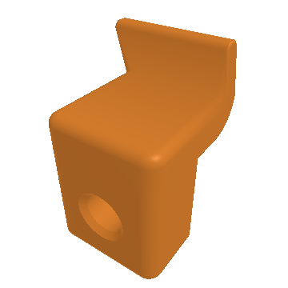
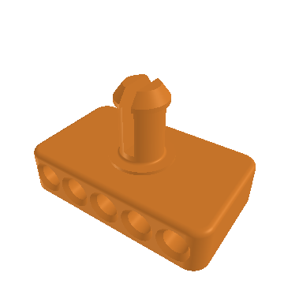
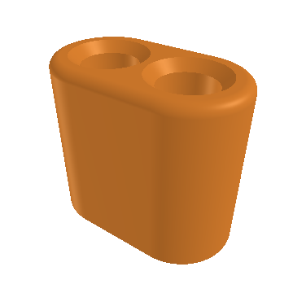
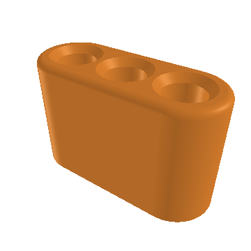
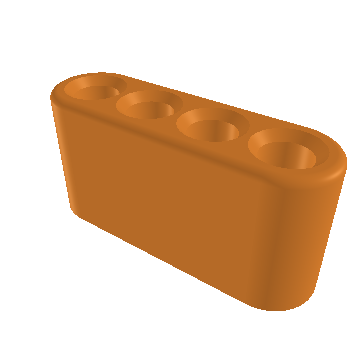
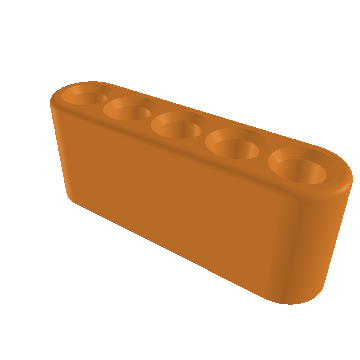
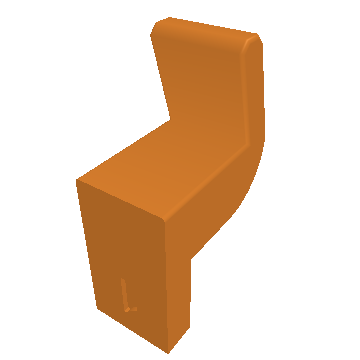
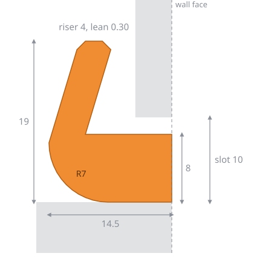

# Slatwall accessories

Parametric [build123d](https://github.com/gumyr/build123d) slatwall parts, plus a few standalone
helpers. First set: PTFE tube routing for 3D printers.

**Verified to fit ProSlat carbon fiber slatwall.** The hook was designed from my own measurements
and refined over six printed fit tests. It is **not** a generic 3"-pitch slatwall hook. Print
`hook/fit_test.stl` first to check it on your panel.

## Parts

All STLs are in print orientation, with no supports needed.

| | File | Description |
|---|---|---|
|  | [`ptfe/stl/swivel_base.stl`](ptfe/stl/swivel_base.stl) | Hooks into a slatwall slot and hangs below it. It has a bore with a lead-in chamfer and a rear counterbore for the guide's snap axle. Prints on its side. |
|  | [`ptfe/stl/swivel_guide_5.stl`](ptfe/stl/swivel_guide_5.stl) | Guide block with 5 full sleeves for 4 mm PTFE tube and a split snap axle. Hang the base, then push the axle in from the front until it clicks. It rotates freely, so tubes can leave at any angle. |
|  | [`ptfe/stl/sleeve_2.stl`](ptfe/stl/sleeve_2.stl) | Standalone bundling sleeve for 2 tubes (not slatwall). |
|  | [`ptfe/stl/sleeve_3.stl`](ptfe/stl/sleeve_3.stl) | Standalone bundling sleeve for 3 tubes. |
|  | [`ptfe/stl/sleeve_4.stl`](ptfe/stl/sleeve_4.stl) | Standalone bundling sleeve for 4 tubes. |
|  | [`ptfe/stl/sleeve_5.stl`](ptfe/stl/sleeve_5.stl) | Standalone bundling sleeve for 5 tubes. |
|  | [`hook/fit_test.stl`](hook/fit_test.stl) | Hook fit coupon. It prints in a few minutes; check it seats and doesn't wobble before you print real parts. |

PTFE holes are 4.4 mm (a sliding fit for 4 mm OD tube in PETG) at 6.6 mm pitch, chamfered at both ends.

Ready-made PrusaSlicer projects (MK4 Input Shaper, HF0.6 nozzle, Prusament PETG, 2 perimeters,
30% gyroid):

- [`ptfe/slatwall_ptfe_plate.3mf`](ptfe/slatwall_ptfe_plate.3mf): 4× 2-tube, 2× 3-tube, 2× 4-tube and
  4× 5-tube sleeves, plus 4 swivel sets. 0.15 mm layers, about 6 h.
- [`hook/hook_fit_test.3mf`](hook/hook_fit_test.3mf): the fit coupon at 0.40 mm layers.

## The hook: reuse it for anything



Every part hangs from the same hook profile. Seen from the side it's a thick "Z":

- a flat 8 mm bar through the 10 mm slot, reaching 14.5 mm behind the wall face;
- a 4 mm riser up to 19 mm, leaning forward 0.30 mm per mm of height, like the panel maker's
  own wire hook;
- a 7 mm radius on the lower back corner, so the part can rock in through the slot.

**In other CAD tools**, use the files in [`hook/`](hook/):

| File | What |
|---|---|
| `hook_profile.dxf` / `.svg` | 2D side profile, in mm. Wall face at X=0, slot bottom at Y=0, the wall toward -X. |
| `hook_10mm.step`, `hook_20mm.step` | Bare hook bodies, 10 or 20 mm wide. Union one onto the back of your part: the attach face is Y=0, Z 0..8, with 0.5 mm of overlap. |

**In build123d**, use the `slathook` package:

```python
from slathook import hooked_body, hook_part, on_side, NECK_TOP

p = hooked_body(width=24, body_d=14, z0=-30)   # hook + a block hanging below the slot
with p:
    ...                                       # keep modelling: holes, pockets, etc.
part = on_side(p.part)                        # print orientation: profile flat on the bed

part2 = my_body + hook_part(width=20)          # or fuse the bare hook onto any body
```

Rules for new accessories:

- **Nothing in front of the wall may rise above the bar top (`NECK_TOP`, 8 mm).** It would hit
  the slat above while you tilt the part in, so hang bodies below the slot.
- **Don't fill in the hook.** Solid wedge-shaped hooks won't go in: the face lip has to swing into
  the open space between the bar and the riser.
- For bodies taller than about 125 mm, add a second hook one slot down (`SLOT_PITCH`, 120.65 mm = 4 3/4")
  so the part can't rotate.
- If you change the hook shape, check it with the insertion simulator first:
  `uv run python -m slathook.tiltsim`. It does a 2D search of the tilt-in motion.
  [`slathook/history.py`](slathook/history.py) has every shape tried and what each fit test showed.

## Shelf bracket study (`bracket/`)

A physics-driven search for the strongest shelf bracket per gram of plastic: a small 2D FEA
solver with one-sided wall contact, creep and buckling checks, topology optimization, truss
layout optimization and parameter searches over nine designs (architecture-inspired, optimized,
minimalist and organic). The bracket spans two slots: the hook in one, a rest tab in the next.

- Report: `bracket/report/bracket_study.html` (open in a browser)
- Print-ready winner: `bracket/out/print/hanging_arch_rest.3mf`, the hanging arch, 0.40 mm layers in PETG,
  about 45 g and 14.4 kg safe per bracket (simulated; load-test before trusting it)
- STLs for every design: `bracket/out/bracket_*.stl`

## Shelf generator (`bracket/shelf_gen.py`)

**In the browser:** https://nick-pape.github.io/slatwall-accessories/shelf/ (no install; 3D preview,
STL or ready-to-slice 3MF). It runs the same geometry code (`bracket/shelf_geom.py`) in Pyodide and
looks the design up in a capacity table (`site/shelf/table.json`) instead of solving: the FEA is a
2D profile x width, so safe load and mass scale exactly with width and one solve per depth covers
every width. Rebuild the table after changing the geometry or the FEA with
`uv run python bracket/shelf_table.py`; the site deploys from `site/` via GitHub Actions
(`tools/build_site.py`).

One-piece shelves printed standing (profile on the bed, width = print height), built from three
identical twin-wall ladders with joints only where they overlap. Give it a size; it picks the shape:

```sh
cd bracket
uv run python shelf_gen.py 152.4 101.6 --lip 1.5 --open    # 6" x 4" shelf with a chamfered lip
uv run python shelf_gen.py 215 230                          # the biggest that fits an MK4
```

- **Rating:** a water column over the deck (`--water-cm 20` default, about 2-liter bottles packed
  edge to edge), or a fixed `--load` in kg. Checked for creep, strength, buckling and tip sag.
- **Shapes it chooses between:** an L (deck + short ladder stub, stub length computed) for shallow
  shelves, a 45-degree triangle with its foot on the wall face, and a triangle into the next slot
  once a 45-degree diagonal would reach it. The lightest one that passes wins.
- `variants.py W D` puts the best L and best triangle, with and without the lip, on one plate.

## Layout

```
slathook/   the reusable hook package: hook.py (profile + helpers), tiltsim.py, history.py
hook/       generated hook files: DXF/SVG profile, STEP bodies, fit-test STL + 3MF
ptfe/       PTFE parts: ptfe_mount.py, stl/, print plate 3MF
bracket/    shelf bracket study: FEA solver, optimizers, designs, report
tools/      make_3mf.py (packs STLs into a PrusaSlicer project), render.py, prusa/*.ini configs
docs/img/   README images
build.py    rebuilds everything
```

## Build

```sh
uv sync
uv run python build.py
```

## Disclaimer

This is an independent hobby project. It isn't affiliated with or endorsed by any slatwall
manufacturer, and it wasn't made from any manufacturer's drawings or files. "ProSlat" is a trademark
of its owner and is used here only to describe what these parts fit. The dimensions are my own
measurements. There is no warranty: test printed parts before hanging anything heavy or valuable on them.
